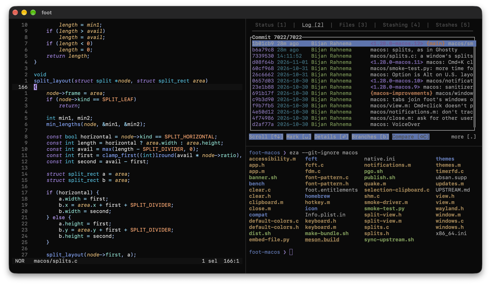

# foot for macOS

[](https://github.com/sponsors/gobijan)

A native macOS port of [foot](https://codeberg.org/dnkl/foot), the fast,
lightweight and minimalistic terminal emulator. The port is developed
and maintained by [Bijan Rahnema](https://github.com/gobijan); it is
unofficial, and not affiliated with upstream foot.



**Status:** work in progress. Usable day to day, but expect rough edges.

foot's terminal core (VT parser, grid, sixel, search, URL mode etc) is
unchanged. Only the platform layer is new, and it is native - no
Wayland compositor, no X11, no emulation:

| | Upstream (Linux) | macOS |
|---|---|---|
| Windows, input | Wayland | AppKit |
| Presentation | `wl_shm` buffers | IOSurfaces as `CALayer` contents (zero copy) |
| Frame pacing | frame callbacks | `CADisplayLink` (paused when idle or hidden) |
| Event loop | epoll | kqueue, integrated with the main run loop |
| Fonts | fcft (fontconfig, FreeType, HarfBuzz) | fcft API implemented on CoreText |
| Keyboard | xkbcommon keymap from the compositor | xkbcommon keymap generated from the macOS layout |
| Input methods | text-input-v3 | `NSTextInputClient` (dead keys, IMEs) |
| Clipboard | Wayland data devices | `NSPasteboard` |

Rendering is still done on the CPU, with pixman, exactly like upstream
foot; that is what keeps it lean (an idle window uses next to no CPU
and ~30MB of memory, and wakes up less than once a second; see
[Performance](#performance)).

## Performance

foot against kitty and Ghostty on the same Mac. foot starts the
fastest, and is the leanest while idle. Ghostty processes output the
fastest; foot is behind kitty with text, and well ahead of it when
scrolling:

<!-- bench: generated by macos/bench/bench.py --save -->
| MiB/s, 160x50 (higher is better) | foot | kitty | Ghostty |
| --- | --: | --: | --: |
| ASCII text | 90 | 117 | **240** |
| Unicode text | 62 | 78 | **90** |
| Colored cells | 112 | 124 | **126** |
| Scrolling | **48** | 9 | 46 |
| Scrolling region | 50 | 24 | **66** |
| Cursor motion | 92 | 105 | **202** |
| Window (pixels) | 1280×850 | 1440×800 | 1280×800 |

| Lower is better | foot | kitty | Ghostty |
| --- | --: | --: | --: |
| Startup, until the command runs (ms) | **75** | 683 | 155 |
| Memory, idle window 160x50 (MiB) | **31** | 86 | 62 |
| CPU, idle window (%) | **0.04** | 0.29 | 0.65 |
| Wakeups, idle window (per second) | **0.3** | 2.3 | 16.2 |

Mac Studio (Apple M1 Max, 32 GB), macOS 27.0.1, a 3840×1600 display at 144 Hz; foot 1.28.0-macos.2-2-g61bb508f, kitty 0.49.2, Ghostty 1.3.2-main+f54340ad7; each with its default configuration and Menlo 14, on 2026-10-25. [All results (and a 400x88 window)](../macos/bench/results.md), and [how they are measured](../macos/bench/README.md); `make bench` measures them on your Mac.
<!-- /bench -->

## Supporting the port

The port is a lot of ongoing work: the native platform layer, signed
and notarized releases, automatic updates, the Homebrew cask, and
keeping up with upstream foot every week. If you use foot on your Mac,
please consider [sponsoring its development](https://github.com/sponsors/gobijan).

Sponsorships go to the macOS port, not to upstream foot.

## Installing

With [Homebrew](https://brew.sh):

```sh
brew install --cask gobijan/tap/foot
```

Or download `foot-<version>.zip` from the
[latest release](https://github.com/gobijan/foot-macos/releases/latest),
and move `foot.app` to Applications. It's a universal app (Apple
silicon and Intel) for macOS 14 and later, signed and notarized.

foot updates itself (foot > Check for Updates…, with
[Sparkle](https://sparkle-project.org)); on the second launch, it asks
whether to check automatically, once a day. Homebrew's cask also puts
`foot` and `footclient` in your `$PATH`.

## Building

Requirements: Xcode (or the command line tools), and
`brew install meson ninja bison` (or `make deps`).

```sh
make install    # builds foot.app, and installs it to /Applications
```

Releases are built with profile guided optimization, and are faster
than that: `make pgo` before `make install` does the same (a window
opens for a few seconds, processing the benchmark's workloads).

`make` lists all commands: building and running the debug and release
builds, tests, upstream syncs, CI. The Makefile is only a frontend for
meson; without it:

```sh
meson setup build --native-file macos/native.ini --buildtype=release
ninja -C build
cp -R build/macos/foot.app /Applications/
```

This builds `foot.app` (with `foot` and `footclient` inside
`foot.app/Contents/MacOS/`). Without installing it, run
`./build/macos/foot` directly.

All dependencies (pixman, utf8proc, xkbcommon) are built from source,
and linked statically; the resulting binary only depends on system
frameworks.

## macOS specifics

* `Cmd+C` / `Cmd+V` copy and paste, `Cmd+N` opens a new window (in the
  same process, and in the current window's working directory), `Cmd+,`
  opens the configuration in `$EDITOR`, `Cmd+=` / `Cmd+-` / `Cmd+0`
  change the font size, `Cmd+Shift+O` shows URLs (like foot's
  `Ctrl+Shift+O`), `Ctrl+Cmd+F` toggles fullscreen. foot's own key
  bindings (e.g. `Ctrl+Shift+C`) still work.
* `Cmd+K` clears the scrollback and everything above the prompt, which
  moves to the top, also while a command is running. What's been typed
  stays. With shell integration (OSC 133), a prompt of several rows
  stays whole. `Cmd+Option+K` clears only the scrollback.
* `Cmd+T` opens a tab, in the current window's working directory:
  native tabs, so the tab bar, dragging tabs between windows and View >
  Show All Tabs work as in other Mac apps. `Cmd+1` to `Cmd+8` select a
  tab, `Cmd+9` the last one, `Cmd+Shift+[` and `Cmd+Shift+]` the
  previous and the next one.
* Splits, like Ghostty's: `Cmd+D` splits the focused terminal into two,
  side by side, `Cmd+Shift+D` stacked (Shell > Split Left and Split Up
  too), with the new one in the same working directory. A click, or
  `Cmd+Option+arrow`, focuses another one; `Cmd+[` and `Cmd+]` the
  previous and the next one. The others are dimmed. The dividers can be
  dragged, or moved with `Cmd+Ctrl+arrow`; `Cmd+Ctrl+=` makes all the
  same size. `Cmd+Shift+Return` zooms the focused one to the whole
  window, and back. `Cmd+W` closes it, `Cmd+Shift+W` the whole window,
  with all tabs and splits. Each split is a terminal of its own (e.g.
  its font size).
* `Cmd`+click opens a URL or a hyperlink (OSC 8), with `[url]`'s
  `launch`; the mouse pointer shows which text is one while `Cmd` is
  down.
* Like other Mac apps, foot keeps running when its last window is
  closed, until `Cmd+Q`; the Dock icon opens a new window. Started from
  a shell, foot exits with its last window, as on Linux.
* On U.S., U.S. International and ABC layouts, the left Option key is
  Alt/Meta, and the right one produces characters. Other layouts need
  Option for characters like `@` or `[`, so both keys produce characters
  there (like on any Mac). `macos-option-as-alt=none|left|right|both` in
  `[main]` changes that. On keys without text (arrows, Return, Backspace
  etc), Option always is Alt.
* The configuration is read from `~/.config/foot/foot.ini`. New windows
  re-read it, so changes apply without restarting foot.
* Font sizes are in points, like in other macOS applications. The
  default font is SF Mono (`monospace`), 13pt. Icons from installed Nerd
  Fonts are used automatically.
* There's some room around the text: 8pt (`pad=8x8` in `[main]`;
  upstream's default is none).
* Glyphs are thickened (font smoothing) like macOS' own text rendering,
  which matters most on non-Retina displays. Tune it with
  `macos-font-smoothing-strength=0.0-1.0`, or turn it off with
  `macos-font-smoothing=no`, in `[main]`.
* The default colors are Grok Night (dark) and Grok Day (light), the
  palette of xAI's Grok
  ([grok-build](https://github.com/xai-org/grok-build), Apache-2.0).
* Color themes: pick one in View > Theme. foot's themes (Catppuccin,
  Dracula, Gruvbox, Nord, Solarized, Tokyo Night and 80 more, and Grok)
  are bundled in `foot.app/Contents/Resources/themes/`; the menu writes
  the `include=` line to `foot.ini` (and leaves the rest of the file as
  it is), and all windows switch right away. Default Colors removes it
  again. Colors set in `foot.ini` itself take precedence. Hundreds more
  themes, in foot's format, are in the `foot/` directory of
  [iTerm2-Color-Schemes](https://github.com/mbadolato/iTerm2-Color-Schemes).
* foot follows the system's light/dark mode, with a dark and a light
  theme (View > Theme > Follow System Appearance,
  `macos-follow-appearance=yes` in `[main]`, on by default): a theme
  with dark colors only replaces Grok Night, one with light colors only
  Grok Day. For one theme in both modes, turn it off. Programs that ask
  for theme changes (mode 2031, e.g. Neovim) are notified.
* Closing a window asks first when something other than the shell is
  running in it (tmux, screen and zellij don't count: they keep
  running). So does quitting, without [sessions](#sessions).
  `macos-confirm-close=no` in `[main]` turns that off.
* Desktop notifications (OSC 9, 99 and 777, `bell=notify`) are foot's
  own in Notification Center: macOS asks for the permission once, and
  clicking one leads back to its terminal. A
  `command=` in `[desktop-notifications]` replaces that. None appear
  while foot's window has the focus (`inhibit-when-focused`). If there
  are none otherwise, turn them on in System Settings > Notifications >
  foot: macOS doesn't ask again after a no, or when foot exited while
  it was asking.
* Drop a folder on the Dock icon, or use Open With in the Finder, to
  open a window in it; a script opened that way runs in a window that
  stays until it's closed. The Finder's context menu has New foot Window
  Here and New foot Tab Here (Services, or Quick Actions, once enabled
  in System Settings > Keyboard > Keyboard Shortcuts > Services).
* foot > Secure Keyboard Entry keeps other processes from seeing what's
  typed in foot, e.g. passwords. Like in Terminal.app, it's off by
  default, and stays on until it's turned off; meanwhile, tools that
  watch the keyboard don't work while foot is active.
* VoiceOver and other assistive technologies see the visible part of
  the terminal as a text area, line by line, with the cursor as its
  insertion point.
* The shell is started as a login shell, so that it sets up `$PATH`.
* `TERM=foot`; the terminfo entry is bundled, and found through
  `$TERMINFO_DIRS`.

## Sessions

What runs in foot keeps running when foot quits (`Cmd+Q`), crashes, or
is updated. When foot starts again, its windows are back, with their
tabs and splits, where they were, and with what's in them, scrollback
included; the programs in them didn't notice. Closing a window (or a
split) ends what runs in it, as before.

* The programs run in footd, foot's sessions (in foot.app, next to
  foot). foot starts it when it's needed, and it exits once there are
  neither sessions nor foot windows left; it does nothing while idle.
  Each window's terminal is attached to a session: what the programs
  write comes from footd, as it would from a PTY.
* footd keeps a session's state while no window is attached, and
  answers the programs' queries (colors, size) meanwhile. A window that
  attaches gets that state first: the screen (and the alternate one,
  e.g. Vim's or htop's), the scrollback, wrapped lines, the cursor,
  modes, colors, title and links. Not kept: sixel images, and the title
  and color stacks.
* The quake terminal is a session too: the next foot shows it as it
  was.
* foot started from a shell (e.g. `foot -e htop`) and footclient's
  terminals are as upstream's: they end with foot.
* foot > Quit and End Sessions (`Option+Cmd+Q`) quits as without
  sessions: what runs in foot ends too, the shells included. It always
  asks first (unless `macos-confirm-close=no`).
  `macos-sessions=no` in `[main]` turns sessions off.
* footd's socket is `~/Library/Application Support/foot/sessions-1.sock`.
  A foot with another session protocol (after an update that changes
  it) gets a footd of its own; the old one keeps its sessions until
  they end.
* Output passes through footd as fast as directly when it's text, and
  up to 30% slower with lots of control sequences (e.g. a full screen
  redrawn hundreds of thousands of times a second, `make bench`'s
  `cursor_motion`); typing is just as fast.

### Sessions on other machines

Shell > New Window on (or New Tab on) opens a window whose session runs
on another machine, over SSH: e.g. a server, or another Mac. It keeps
running there when the connection is lost (the Mac sleeps, the network
changes) and when foot quits. After foot restarts, the window is back,
as the others.

When the connection is lost, the window says so, and foot connects
again: after a second, then a few more times during two minutes; after
that, when the network changes, or when you type. A connection that
hangs (e.g. after sleep, or on another Wi-Fi) is noticed when the
network changes, or when you type after a quiet while: it's checked,
and if nothing answers within 5 seconds, it's connected anew. Nothing
is sent while the windows are idle.

* Shell > Connections (Shift+Cmd+K) lists the machines, and how
  they're connected: connected (with how many sessions), connecting,
  can't connect (and why), footd being installed. There, + adds one
  (an address as for ssh: `user@host`, or a host in `~/.ssh/config`;
  and a name, if you like), − removes it from the list, and New Window
  or New Tab (or a double-click) opens one there. Its menu: edit it,
  remove footd from it.
* The machines offered: those in Connections (those Other… was used
  for too), and those in `~/.ssh/config`. Other… asks for one
  (`user@host`, as for ssh). This Mac: here.
* New windows, tabs and splits open where the focused terminal runs.
  The title starts with the machine: its name in Connections, or else
  its host.
* foot runs `ssh -T -o BatchMode=yes HOST footd --bridge`: your SSH
  configuration and keys (the agent) are used, without asking for
  passwords. One connection per machine, for all its windows; once
  none is open there any more, it's closed (after half a minute: a
  window opened meanwhile uses it). A
  machine's key is trusted the first time (added to
  `~/.ssh/known_hosts`), not when it has changed.
* footd must be there. If it isn't, the window offers to install it:
  Enter copies it to `~/.local/bin/footd` there (one file, no sudo).
  foot.app has it for Linux (x86_64 and aarch64, linked statically: any
  distribution) and macOS. An older one there is replaced without
  asking. Also used: foot.app in `/Applications` (on a Mac), and footd
  in `$PATH`.
* Shell > Remove footd from (in a window on that machine) removes it
  again; the sessions there end.
* A session there gets that machine's environment (the SSH login's),
  its user's shell, home and `foot.ini`. `TERM` is foot's, if there's
  terminfo for it there; else `xterm-256color`.
* Not there yet: asking before closing a window when something runs in
  it, and dragging files into it (their paths are this Mac's).

## Quake terminal

A drop-down terminal: it slides in from an edge of the screen, over
other applications (full screen ones too), on every Space. By default,
as Omarchy's quake console, it's half the screen high and twice as wide
as high, centered at the top, and darkens the rest of the screen.
Shell > Show Quake Terminal (also in the Dock icon's menu) shows it,
starting its shell the first time, and hides it again. Toggled while
it's shown, but not focused, it gets the focus. Its shell runs until it
exits (or `Cmd+W`); the next time, a new one starts, in the home
directory.

Its global hotkey is Option+\` (`macos-quake-hotkey=Mod1+grave` in
`[main]`): the key below Esc. It works while foot runs as an
application (started from the Finder, the Dock or at login, not from a
shell), and needs no permissions. To change it, give the modifiers
(`Shift`, `Control`, `Mod1` for Option, `Mod4` for Command) and an XKB
key name (e.g. `grave`, `space`, `F12`: the key that types it without
modifiers, in the current keyboard layout), or `none`; foot has to be
started again. If another application uses the same keys (e.g. OmniWM's
own quake terminal), give one of them other keys.

These options in `[main]` control it; they're read each time it's
shown or hidden:

| Option | Default | |
|---|---|---|
| `macos-quake-hotkey` | `Mod1+grave` | The global hotkey (Option+\`), or `none` |
| `macos-quake-position` | `top` | `top`, `bottom`, `left` or `right` (slides in from that edge), or `center` (fades in) |
| `macos-quake-size` | `50` | The height, or `WIDTHxHEIGHT`, in percent of the screen (without the menu bar and the Dock). Without a width, it's twice as wide as high (at most the screen's width); `100x50`: as wide as the screen |
| `macos-quake-alpha` | the color theme's | Background opacity, `0.0`-`1.0` |
| `macos-quake-dim` | `0.6` | How much the rest of the screen is darkened while it has the keyboard focus, `0.0`-`1.0`; `0`: not at all |
| `macos-quake-auto-hide` | `yes` | Hides it when it loses the keyboard focus |
| `macos-quake-animation-duration` | `0.3,0.2` | In seconds, showing and hiding (one value: both); `0`: no animation. With Reduce Motion, it fades |
| `macos-quake-area` | `screen` | `X,Y,WIDTH,HEIGHT`: the area it's placed in instead, in points, in AppKit's screen coordinates (origin at the bottom left of the main display) |

It's shown on the screen with the keyboard focus.

### Window managers, hotkey tools: footclient

foot's server has a quake terminal too, controlled by `footclient`;
e.g. from a window manager, or another hotkey tool (skhd, Hammerspoon,
Raycast, …):

```sh
foot --server &
footclient --quake          # toggles it
footclient --quake=show     # or hide, or status
```

Each prints its state afterwards, `visible` or `hidden`. `hide` starts it
hidden if it isn't running yet (so that it's there right away when
shown); `status` changes nothing. A new quake terminal gets that
footclient's command, working directory, `-E` and `-o`. With
`footclient --quake -o …`, the `macos-quake-*` options apply right away,
for that call (options that aren't given are those the server started
with); this is how a window manager can control it.

While the server has no other windows, foot isn't in the Dock (or the
application switcher). Window managers can tell the quake terminal by
its Accessibility subrole, `AXFloatingWindow`, and identifier,
`io.github.gobijan.foot.quake`.

## Everything else

The terminal itself works as in upstream foot: key bindings, scrollback
search, URL mode, server mode (`footclient`), shell integration,
control sequences and all configuration options. See foot's
[README](https://codeberg.org/dnkl/foot/src/branch/master/README.md),
and its man pages: [foot(1)](../doc/foot.1.scd),
[foot.ini(5)](../doc/foot.ini.5.scd),
[footclient(1)](../doc/footclient.1.scd) and
[foot-ctlseqs(7)](../doc/foot-ctlseqs.7.scd). Wayland specific parts
(compositors, fractional scaling, touchscreens) don't apply on macOS.

## Contributing

AI-assisted contributions are explicitly welcome, unlike upstream:
patches, bug reports and comments alike. See
[CONTRIBUTING.md](CONTRIBUTING.md).

## Bugs

Please report bugs to https://github.com/gobijan/foot-macos/issues, not
upstream.

Before you open a new issue, please search existing bug reports, both
open **and** closed ones. Chances are someone else has already
reported the same issue.

The report should contain the following:

- Foot version (`foot --version`).
- Log output from foot (run `foot -d info` from another terminal).
- Which macOS version you are running (`sw_vers`).
- If reporting a crash, please try to provide a `bt full` backtrace
  with symbols.
- Steps to reproduce. The more details the better.

## Staying in sync with upstream

The port is designed to make merging upstream foot routine: new code
lives in `macos/`, and upstream files are touched as little as
possible. A weekly GitHub workflow merges upstream, and opens a pull
request when the result builds and passes the tests. See
[macos/UPSTREAM.md](../macos/UPSTREAM.md).

## Credits

foot is written by [Daniel Eklöf](https://codeberg.org/dnkl) and
contributors.

The macOS port is developed and maintained by
[Bijan Rahnema](https://github.com/gobijan): the native platform layer,
and everything the port adds to foot, such as native tabs, splits, the
quake terminal, notifications, and signed releases with automatic
updates.

The app icon is based on foot's logo, designed by
[Ordoviz](https://codeberg.org/Ordoviz).

## License

MIT, like upstream foot; see [LICENSE](../LICENSE).
